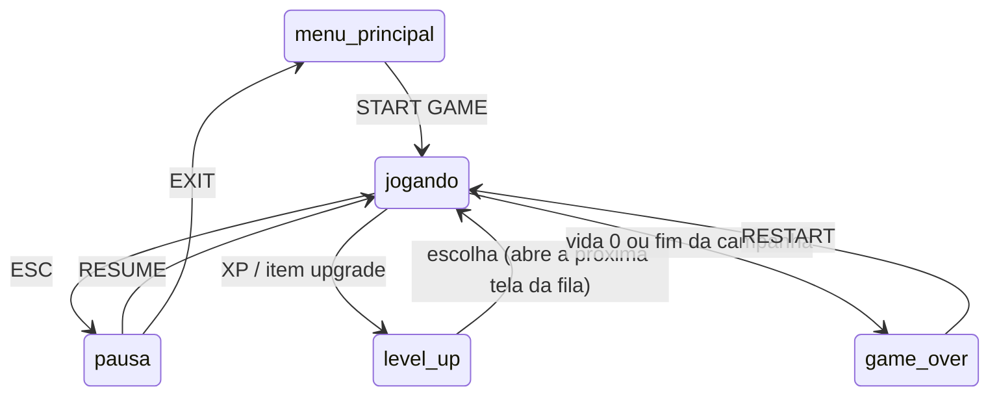

# Arquitetura

## Loop e estados
`main.py` inicializa o pygame, abre a janela de 1280×720 e chama `Game(tela).run()`. A cada frame:

```
n = acumulador.passos(clock.tick(60)/1000)   # passo fixo: quantos 1/60 s couberam (máx. 5)
EventManager.processar()   # despacha o evento pelo estado atual (dict estado -> handler)
Game.update(1/60) × n      # só roda no estado 'jogando'
Renderer.draw()            # um por frame; despacha pelo estado; envolve tudo em try e loga cada erro 1x
```

**Estados** (`game.estado_do_jogo`): `menu_principal`, `jogando`, `pausa`, `level_up`, `configuracoes`, `colaboradores`, `ranking`, `game_over`. `EventManager._dispatch` e `Renderer._dispatch` precisam ter as **mesmas** chaves, e há um teste que verifica isso.



## Game.update (ordem importa)
1. `relogio.avancar(dt)`: este é o **único** lugar onde o relógio de jogo avança.
2. Portal: aparece 2000 ms depois que o boss morre. Encostar nele chama `StageManager.iniciar_transicao()`.
3. `timer_jogo` e `Spawner.update` só rodam quando não há boss, transição nem portal.
4. Atualizações: `Player.update(dt, paredes)`, depois cada arma `.update(dt)`, depois os sprites (os inimigos recebem `paredes`).
5. `CollisionManager.update`, nesta ordem:
   - projétil do jogador contra inimigos (o mais próximo primeiro; perfuração finita acerta cada alvo uma vez só);
   - projétil inimigo contra a hitbox do jogador;
   - contato (com espinhos);
   - coleta de itens;
   - auras (DPS × dt);
   - morte dos inimigos (`morrer` gera os drops).
6. `StageManager.update` cuida do fade: no meio dele troca mapa, câmera e spawner e mata os sprites que não sobrevivem (player, companions, aura).
7. Se `player.vida_atual <= 0`, a partida termina: calcula a pontuação final e vai para `game_over`.

## Singletons e estado global
- `entity_manager` (`systems/entitymanager.py`): guarda os grupos `all_sprites`, `inimigos_grupo`, `projeteis_jogador_grupo`, `projeteis_inimigos_grupo`, `items_grupo`, `auras_grupo` e o `player`. `Game._resetar_estado_jogo` esvazia esses grupos. O `Game` mantém aliases (`game.all_sprites` etc.) para compatibilidade.
- `relogio` (`systems/gameclock.py`): conta em ms, começa em 60 000 para que cooldowns com `ultimo = 0` já nasçam prontos, e fica congelado fora de `jogando`.
- Caches de classe: `ProjetilUniversal.GLOBAL_CACHE`, `EnemySprites.GLOBAL_SPRITE_CACHE`, `items.draw.GLOBAL_CACHE` e os caches da HUD.
- `source/feats/assets.py`: no **import**, faz `pygame.init()`, abre uma janela oculta e carrega todas as imagens em `ASSETS`, com caminhos relativos ao cwd ou ao `sys._MEIPASS` no exe.

## Entidades
| Entidade | Composição | Notas |
|---|---|---|
| `Player` | `Sprite` + mixins `Input/Movement/Animation/Combat/Scaling/Setup` | dano: veículo → escudo → vida; i-frames de 100 ms |
| `BaseEnemy` | `Sprite` + `EnemySetup/Sprites/Animation/Movement/Collision/Combat/Scaling/Effects` | escala no construtor pelo nível do player: `1 + nivel/10` (vida e dano) e `1 + nivel/100` (velocidade) |
| Bosses | `class X(BaseEnemy, XSetup, XAI, XAttacks)` | máquina de estados por string com timestamps de `relogio`. O Arbiter (em andamento) usa rotinas geradoras e `config.py` |
| Armas | `Arma(ABC)` em `feats/weapons/baseweapon.py` | `update` controla a cadência; `disparar()` devolve `True` quando atirou; `upgrade()` faz `nivel += 1` e depois `aplicar_upgrades` |
| Companions e veículos | `Arma` "wrapper" que cria um sprite `Companheiro`/`Vehicle` | ficam em `armas` como qualquer arma |
| Mapa | `MapLoader/MapCollision/MapUtils/MapFeats` | lê as camadas Tiled `Colisoes`, `SpawnPoints`, `SpawnPlayer`, `Portal`, `Void`, `VoidPoint`, `Navigation` |

## Fluxos principais
- **XP e level-up:**
  1. Um item é coletado e chama `ganhar_xp`.
  2. O `while` processa todos os níveis devidos.
  3. Cada nível vai para `fila_upgrades`.
  4. Abre-se uma `TelaDeUpgrade` por vez (estado `level_up`).
  5. `EventManager._aplicar_escolha_de_upgrade` faz `upgrade()` numa arma que o jogador já tem, ou instancia `ArmaInfo.classe(player, grupos, game, criar_sprite=True)`.
- **Upgrade de stats:** cada `WeaponStats(value, label, increase, range_val, min_val)` sobe quando `_deve_melhorar(range_val, nivel)` é verdadeiro. `range_val` pode ser um int (a cada N níveis) ou uma lista (níveis exatos). Não existe teto de nível.
- **Drops:** `Items.spawn_drop(pos, grupos, tipo=(qtd, prob, escala) | ((qtds), (probs), escala))`. Quando as probabilidades somam menos que a escala, o que falta vai para a opção mais provável.
- **Fases:**
  - `PHASE_POOLS[fase]` define os inimigos (`random.choices` com pesos).
  - `PHASE_BOSSES[fase]` e `CRONOGRAMA_BOSSES` (em segundos de `timer_jogo`, **acumulado entre fases**) definem os bosses.
  - Há um teto de 250 inimigos vivos.
  - O intervalo entre spawns é `max(0.5, 2.5 - timer*0.002)`.

## Decisões técnicas (extraídas dos comentários no código)
- **Relógio de jogo próprio** em vez de `get_ticks`: pausa e level-up quebravam cooldowns, i-frames e timers de boss.
- **Passo fixo de 1/60 s** (`AcumuladorPassoFixo` em `gameclock.py`, roteiro B1): a física não depende do FPS e o jogo roda igual aos testes. No máximo 5 passos por frame; o atraso além disso é descartado (o jogo desacelera em vez de entrar em espiral). O movimento do player ainda limita o dt a 0.033 s.
- **`Renderer` engole exceções de desenho** e loga cada uma só uma vez: um sprite quebrado não derruba o jogo. Por isso os testes conferem `renderer._erros_logados`.
- **`RankingData`** grava de forma atômica (arquivo `.tmp` + `os.replace`), sanitiza os dados e faz backup de um JSON corrompido. Nunca lança exceção.
- **`MAX_INIMIGOS_VIVOS = 250`**: evita a espiral de morte da colisão O(projéteis × inimigos).
- **Cheats só com `MCE_DEBUG=1`** (`source/debug.py`).
