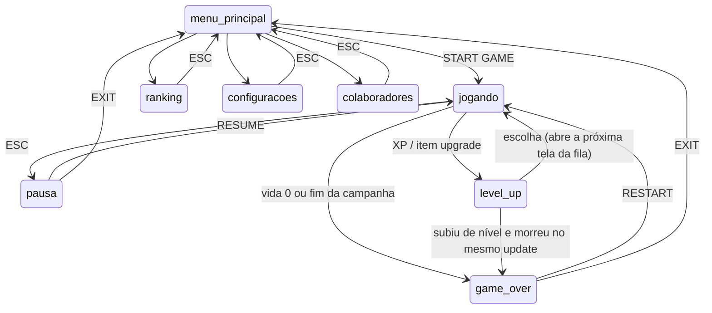

# Arquitetura

## Loop e estados
`main.py` inicializa o pygame, abre a janela de 1280×720 e chama `Game(tela).run()`. A cada frame:

```
n = acumulador.passos(clock.tick(60)/1000)   # passo fixo: quantos 1/60 s couberam (máx. 5)
EventManager.processar()   # entrega cada evento a game.telas[estado].evento
Game.update(1/60) × n      # só roda no estado 'jogando'
Renderer.draw()            # um por frame; chama game.telas[estado].desenhar dentro de try e loga cada erro 1x
```

**Estados** (`systems/estados.py`): `menu_principal`, `jogando`, `pausa`, `level_up`, `configuracoes`, `colaboradores`, `ranking`, `game_over`, como constantes.
- `game.estado_do_jogo` é só leitura. A troca é `game.mudar_estado(CONSTANTE)`, que confere a tabela `TRANSICOES`. Fora dela: com `game.estados_estritos` (testes e `MCE_DEBUG=1`) lança `TransicaoInvalida`; no jogo final loga 1× e aplica (estado inexistente é recusado).
- `game.telas[estado] = Tela(evento, desenhar)` é o registro único lido pelo `EventManager` e pelo `Renderer` (`Game._registrar_telas`).
- Estado novo: constante e `ESTADOS`, linha em `TRANSICOES`, handler `tratar_<estado>` + `desenhar_<estado>` no registro. `test_estados.py` percorre os fluxos reais e exige que as transições feitas sejam **exatamente** a tabela.



## Game.update (ordem importa)
Cada passo é um método nomeado; `test_eventos.py::test_update_roda_os_passos_na_ordem` fixa a ordem.
1. `relogio.avancar(dt)`: este é o **único** lugar onde o relógio de jogo avança.
2. `_atualizar_portal`: o portal aparece 2000 ms depois que o boss morre. `_checar_boss_derrotado` → `boss_derrotado()`. `_checar_portal_tocado`: encostar nele chama `StageManager.iniciar_transicao()`.
3. `_atualizar_spawner`: `sessao.timer_jogo` e `Spawner.update` só rodam quando não há boss, transição nem portal.
4. `_atualizar_status`: conta o tempo dos buffs e debuffs e aplica a queimadura, só nas entidades com efeito ativo (`systems/status`). Vem antes das entidades para o atordoamento já valer neste passo.
5. `_atualizar_entidades`: `Player.update(dt, paredes)`, depois cada arma `.update(dt)` (nenhuma, se o jogador estiver atordoado), depois os sprites (os inimigos recebem `paredes`; inimigo atordoado não é atualizado). `paredes` é a `GradeParedes` do mapa: cada entidade consulta a célula **onde ela está** (`sair_das_paredes`), sem alocar.
6. `CollisionManager.update`, nesta ordem:
   - projétil do jogador contra inimigos (o mais próximo primeiro; perfuração finita acerta cada alvo uma vez só);
   - projétil inimigo contra a hitbox do jogador;
   - contato (com espinhos);
   - coleta de itens;
   - auras (DPS × dt);
   - morte dos inimigos (`morrer` gera os drops; se o inimigo saiu do mundo, emite `inimigo_morreu`).
7. `StageManager.update` cuida do fade: no meio dele troca mapa, câmera e spawner, mata os sprites que não sobrevivem (player, companions, aura) e emite `fase_trocada`.
8. `_checar_game_over`: se `player.vida_atual <= 0`, a partida termina: calcula a pontuação final e vai para `game_over`.

## Eventos de jogo (`systems/eventos.py`)
Barramento síncrono `eventos`: `assinar(nome, funcao)`, `emitir(nome, **dados)` (chama na hora, na ordem de assinatura; a exceção do assinante sobe) e `limpar()`, chamado a cada partida nova. Nome fora de `EVENTOS` é `ValueError`.
| Evento | Dados | Quem emite |
|---|---|---|
| `inimigo_morreu` | `inimigo` | `CollisionManager` (passo 6), só se `morrer()` tirou o inimigo do mundo |
| `boss_derrotado` | `boss`, `fase` | `Game.boss_derrotado` |
| `fase_trocada` | `fase` (a nova) | `StageManager._trocar_dados_fase` |
| `dano_causado` | `alvo`, `dano` (o `Dano`), `valor` (final, depois da regra do alvo) | `receber_dano` do jogador e dos inimigos, só quando o golpe entra (i-frames e golpe ignorado pelo alvo não emitem) |

Ainda não há assinantes no jogo: os consumidores previstos são a memória dos bosses (F3), o áudio (G4) e a pontuação.

## Dano (`systems/dano.py`, roteiro E1)
Todo dano é `alvo.receber_dano(Dano(valor, tipo, fonte, ignora_iframes))`. Tipos: `projetil`, `contato`, `aura`, `area` (explosão, cone, onda, puxão, feixe), `void`, `direto`. `fonte` é a entidade que causou (jogador, inimigo ou `None` para o mapa): projéteis, granadas e habilidades a guardam (`fonte_do_dono`: o que é do jogador é dele; o inimigo passa `fonte=self`, e um teste por AST exige isso).
- **Jogador:** i-frames (ignorados com `ignora_iframes`, que também não os liga) → veículo → escudo → vida.
- **Inimigo:** `ajustar_dano_recebido(valor, dano)` é o gancho da regra do alvo (devolve o valor final, ou `None` para ignorar: Guilty, Hunter, Scarab, consciência do Warden) e `absorver_dano(valor)` tira do escudo e da vida (o Scarab defensivo sobrescreve: só escudo, quebra = stun). Não há i-frames.
- **Invulnerável** (`invulneravel`: invisível, proteção de spawn) é checado por quem causa o dano, não pelo contrato: projéteis e auras checam; artilharia, cone, companheiro, atropelamento e espinhos não (achado da E1, ver log).

## Status: buffs e debuffs (`systems/status/`)
Ponto único: `aplicar(alvo, efeito, fonte=None, chave=None)`, para jogador e inimigos. Os efeitos (`efeitos.py`) são dataclasses validadas (porcentagem = fração; duração em ms; `None` = sem fim, só nos buffs).
| Efeito | Onde age |
|---|---|
| `Lentidao`, `BuffVelocidade` | `mult_velocidade` no movimento: `PlayerMovement.mover_com_colisao`, `EnemyMovement.velocidade_atual()` (usada pelo `mover` e pelos 4 inimigos comuns que se movem sozinhos). Bosses movem-se por conta própria: buff de velocidade neles ainda não tem efeito (F5) |
| `Atordoamento` | o `Game` não chama o `update` do inimigo nem as armas do jogador; o jogador não lê o input; `inofensivo` (sem dano de contato); espinhos, aura do MK2, veículo e aura de energia do dono param |
| `Queimadura` | dano `STATUS` a cada 0,25 s em nome da `fonte` (ignora i-frames sem ligá-los) + corte na `Cura` |
| `Fraqueza`, `BuffDano` | `multiplicador_de_dano(dano, alvo)` no `receber_dano` (buff da fonte × fraqueza do alvo), antes da regra do alvo |
| `BuffCadencia` (só jogador) | `mult_cooldown` em `Arma.update`, no ciclo da Energy Sword e na recarga dos espinhos (companheiros e veículos não) |
| `Cegueira` (só jogador) | `Renderer._draw_mundo` desenha `status/cegueira.py` por cima do mundo e embaixo do HUD |
| `Escudo`, `Cura` | instantâneos: `receber_escudo` (até o máximo) e `receber_cura` (até o máximo, menos o corte da queimadura) |
- Acúmulo: um lugar por (tipo, chave ou fonte); reaplicar no mesmo lugar substitui. Entre lugares: lentidão = a mais forte; queimadura, fraqueza e buffs de dano/velocidade somam; cadência multiplica; atordoamento e cegueira valem enquanto houver um (cegueira: o menor raio).
- Bosses e minibosses declaram `imunidades_status = IMUNIDADES_CHEFE` (sem atordoamento e lentidão de fora); um teste confere todas as classes das pastas `bosses/` e `minibosses/`.
- Custo: os modificadores são recalculados só quando um efeito entra ou sai; sem efeitos, todos são exatamente 1.0 (o golden não muda). 150 inimigos com 4 efeitos cada: 0,27 ms/frame.

## Singletons e estado global
- `entity_manager` (`systems/entitymanager.py`): guarda os grupos `all_sprites`, `inimigos_grupo`, `projeteis_jogador_grupo`, `projeteis_inimigos_grupo`, `items_grupo`, `auras_grupo` e o `player`. `Game._resetar_estado_jogo` esvazia esses grupos. Os grupos se acessam só por aqui (os aliases `game.<grupo>` foram removidos na B3).
- `relogio` (`systems/gameclock.py`): conta em ms, começa em 60 000 para que cooldowns com `ultimo = 0` já nasçam prontos, e fica congelado fora de `jogando`. `relogio.reiniciar()` volta a 60 000 no início de cada partida.

## Sessão (uma partida)
`game.sessao` é uma `SessaoJogo` (`systems/sessao.py`, dataclass): `timer_jogo`, `fase_atual`, `boss_atual`, `portal_atual`, `spawnar_portal_em_breve`, `timer_portal`, `tela_de_upgrade_ativa`, `gravemind_reborns`. `iniciar_novo_jogo` → `_resetar_estado_jogo` reinicia o relógio, esvazia os grupos e cria **objetos novos**: sessão, HUD (guarda tempos da partida), mapa, câmera, player, spawner e stage manager. Estado que vale só durante a partida entra na sessão, não no `Game`. Os sistemas permanentes (menus, ranking, configurações, `CollisionManager`, `Renderer`) não guardam nada da partida.
- Caches de classe: `ProjetilUniversal.GLOBAL_CACHE`, `EnemySprites.GLOBAL_SPRITE_CACHE`, `items.draw.GLOBAL_CACHE` e os caches da HUD.
- `source/feats/assets.py`: o import não tem efeito colateral (D3); `ASSETS` nasce vazio. `carregar_assets()` (idempotente) carrega as imagens do manifesto (`data/manifesto_assets.py`), com caminhos relativos ao cwd ou ao `sys._MEIPASS` no exe; arquivo ausente vira placeholder magenta + aviso. Quem chama: `main.py` (depois de abrir a janela do jogo), o `conftest` e o `tools/perf.py`. Sem janela aberta, ele faz `pygame.init()` e abre uma oculta, porque `convert_alpha` exige uma.
- Os fundos das fases (`ASSETS['maps']`, `MapasSobDemanda`) são a exceção: cada um é decodificado no 1º acesso (~60–190 ms, durante o fade preto da troca de fase) e só os 2 mais recentes ficam na memória. `in`, `len` e a iteração consultam o manifesto; `existe_proxima_fase()` lê `MANIFESTO['maps']`.

## Entidades
| Entidade | Composição | Notas |
|---|---|---|
| `Player` | `Sprite` + mixins `Input/Movement/Animation/Combat/Scaling/Setup` | dano (`receber_dano(Dano)`): i-frames de 100 ms → veículo (absorve tudo) → escudo → vida; os espinhos são chamados pelo `CollisionManager` no contato |
| `BaseEnemy` | `Sprite` + `EnemySetup/Sprites/Animation/Movement/Collision/Combat/Scaling/Effects` | escala no construtor pelo nível do player: `1 + nivel/10` (vida e dano) e `1 + nivel/100` (velocidade) |
| Bosses | `class X(BaseEnemy, XSetup, XAI, XAttacks)` | máquina de estados por string com timestamps de `relogio`. O Arbiter (em andamento) usa rotinas geradoras e `config.py` |
| Armas | `Arma(ABC)` em `feats/weapons/baseweapon.py` | `update` controla a cadência; `disparar()` devolve `True` quando atirou; `upgrade()` faz `nivel += 1` e depois `aplicar_upgrades` |
| Companions e veículos | `Arma` "wrapper" que cria um sprite `Companheiro`/`Vehicle` | ficam em `armas` como qualquer arma |
| Mapa | `MapLoader/MapCollision/MapUtils/MapFeats` | lê as camadas Tiled `Colisoes`, `SpawnPoints`, `SpawnPlayer`, `Portal`, `Void`, `VoidPoint`, `Navigation`; ao fim da leitura monta `grade_paredes` |

## Fluxos principais
- **XP e level-up:**
  1. Um item é coletado e chama `ganhar_xp`.
  2. O `while` processa todos os níveis devidos.
  3. Cada nível vai para `fila_upgrades`.
  4. Abre-se uma `TelaDeUpgrade` por vez (estado `level_up`).
  5. `EventManager._aplicar_escolha_de_upgrade` faz `upgrade()` numa arma que o jogador já tem, ou instancia `ArmaInfo.classe(player, grupos, game, criar_sprite=True)`.
- **Upgrade de stats:** cada `WeaponStats(value, label, increase, range_val, min_val)` sobe quando `_deve_melhorar(range_val, nivel)` é verdadeiro. `range_val` pode ser um int (a cada N níveis) ou uma lista (níveis exatos). Não existe teto de nível.
- **Drops:** `Items.spawn_drop(pos, grupos, tipo=(qtd, prob, escala) | ((qtds), (probs), escala))`. Quando as probabilidades somam menos que a escala, o que falta vai para a opção mais provável.
- **Fases:**
  - `PHASE_POOLS[fase]` define os inimigos (`random.choices` com pesos).
  - `PHASE_BOSSES[fase]` e `CRONOGRAMA_BOSSES` (em segundos de `timer_jogo`, **acumulado entre fases**) definem os bosses.
  - Há um teto de 250 inimigos vivos.
  - O intervalo entre spawns é `max(0.5, 2.5 - timer*0.002)`.

## Decisões técnicas (extraídas dos comentários no código)
- **Relógio de jogo próprio** em vez de `get_ticks`: pausa e level-up quebravam cooldowns, i-frames e timers de boss.
- **Passo fixo de 1/60 s** (`AcumuladorPassoFixo` em `gameclock.py`, roteiro B1): a física não depende do FPS e o jogo roda igual aos testes. No máximo 5 passos por frame; o atraso além disso é descartado (o jogo desacelera em vez de entrar em espiral). O movimento do player ainda limita o dt a 0.033 s.
- **`Renderer` engole exceções de desenho** e loga cada uma só uma vez: um sprite quebrado não derruba o jogo. Por isso os testes conferem `renderer._erros_logados`.
- **`RankingData`** grava de forma atômica (arquivo `.tmp` + `os.replace`), sanitiza os dados e faz backup de um JSON corrompido. Nunca lança exceção.
- **`MAX_INIMIGOS_VIVOS = 250`**: evita a espiral de morte da colisão O(projéteis × inimigos).
- **Cheats só com `MCE_DEBUG=1`** (`source/debug.py`).
